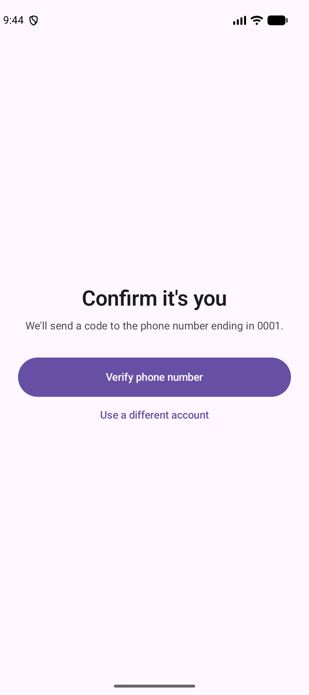
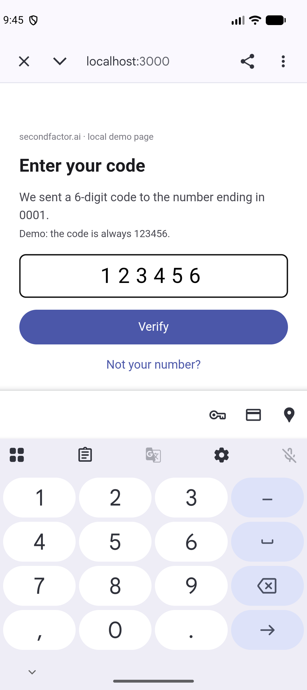
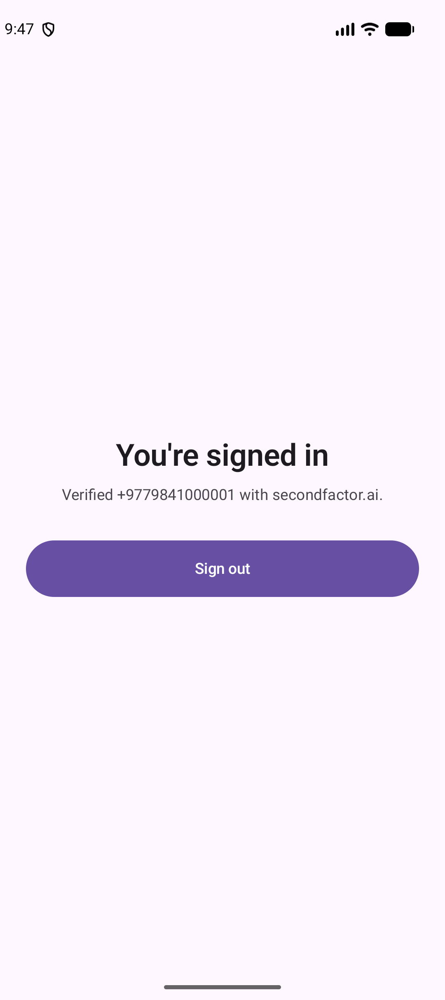

# secondfactor.ai for Android

The client half of [secondfactor.ai](https://secondfactor.ai) hosted
verification, for Android apps written in Kotlin or Java. Your users verify
their phone number on our page, much like Stripe Checkout; this library opens
that page in a Custom Tab and reads the result when the user comes back to
your app.

It is **one Kotlin file** with no dependencies beyond the Android framework:
copy it into your project and you are done. Android 7.0 (API 24) or later.

This library runs on the **user's device**. It never calls the secondfactor.ai
API, and never holds your API key, a phone number or a code. Your server holds
the key and uses a server library:
[`secondfactor`](https://github.com/secondfactor/secondfactor-node) on npm or
[`secondfactor`](https://github.com/secondfactor/secondfactor-python) on PyPI.

> **Act on the result on your server.** What this library reads from a URL is
> not proof of anything: anyone can craft a link that opens your app. Your
> server confirms the session it stored, once, and that answer is the proof.

## Install

The library is not published to Maven. You copy its one file into your app,
and it is short enough to read in full, so you can also treat it as an
example and adapt it.

1. Download
   [`secondfactor/SecondFactor.kt`](https://raw.githubusercontent.com/secondfactor/secondfactor-kotlin/main/secondfactor/SecondFactor.kt)
   into your app module's source tree. Keep the package `ai.secondfactor`, so
   that updating means replacing the file. From your project's root:

   ```bash
   curl --create-dirs -o app/src/main/java/ai/secondfactor/SecondFactor.kt \
     https://raw.githubusercontent.com/secondfactor/secondfactor-kotlin/main/secondfactor/SecondFactor.kt
   ```

2. Make sure your app has the `INTERNET` permission.

The version is in the file's header. To update, download the file again and
read [CHANGELOG.md](CHANGELOG.md).

## How it fits together

1. **Your server** creates a session for the number it wants verified, keeps
   its `sid`, and gives the page's `url` to your app:

   ```js
   // Node, with the `secondfactor` package.
   const session = await sf.createSession({
     to: user.phone,
     returnUrl: "https://app.example.com/verified",
   });
   user.pendingSid = session.sid;
   res.json({ url: session.url });
   ```

2. **Your app** opens the page:

   ```kotlin
   val url = api.startVerification()           // your own call to your server
   SecondFactor.openVerification(this, url)    // `this` is your Activity
   ```

   We send the code, the user types it on our page, and we send them back to
   your `returnUrl`, which Android hands to your app as an App Link.

3. **Your activity** takes the result off the intent and hands it to your
   server:

   ```kotlin
   override fun onCreate(savedInstanceState: Bundle?) {
       super.onCreate(savedInstanceState)
       if (savedInstanceState == null) handleReturn(SecondFactor.takeVerificationReturn(intent))
   }

   override fun onNewIntent(intent: Intent) {
       super.onNewIntent(intent)
       handleReturn(SecondFactor.takeVerificationReturn(intent))
   }

   private fun handleReturn(back: VerificationReturn?) {
       back ?: return                         // not a return from the hosted page
       val token = back.returnToken
       if (token != null) {
           api.finishVerification(token)      // your server calls verifySession
       } else {
           // The user canceled, ran out of attempts, or the session expired.
       }
   }
   ```

4. **Your server** confirms the session it stored, once, and acts on that:

   ```js
   const { phone } = await sf.verifySession(user.pendingSid, req.body.returnToken);
   ```

## Usage

A complete activity, from asking your server for the page to telling the user
how it went. It uses Jetpack Compose and coroutines, which most apps already
have; the library itself needs neither. `MyApi` stands for your app's own
client for your server, with the two endpoints from the steps above.

```kotlin
import ai.secondfactor.SecondFactor
import ai.secondfactor.VerificationReturn
import android.content.ActivityNotFoundException
import android.content.Intent
import android.os.Bundle
import androidx.activity.ComponentActivity
import androidx.activity.compose.setContent
import androidx.compose.foundation.layout.Column
import androidx.compose.material3.Button
import androidx.compose.material3.Text
import androidx.compose.runtime.getValue
import androidx.compose.runtime.mutableStateOf
import androidx.compose.runtime.setValue
import androidx.lifecycle.lifecycleScope
import kotlinx.coroutines.launch

/** Your app's client for your own server. */
interface MyApi {
    /** Asks your server to call `createSession`, and returns the page's `url`. */
    suspend fun startVerification(): String

    /** Hands the return token to your server, which calls `verifySession`. */
    suspend fun finishVerification(returnToken: String)
}

/**
 * Opens the hosted page and shows the result. In the manifest, this activity
 * claims the return URL and has `launchMode="singleTask"`, as described under
 * "Setting up the return URL".
 */
class VerifyPhoneActivity : ComponentActivity() {
    /** Provided by your app, for example through dependency injection. */
    lateinit var api: MyApi

    private var busy by mutableStateOf(false)
    private var message by mutableStateOf("")

    override fun onCreate(savedInstanceState: Bundle?) {
        super.onCreate(savedInstanceState)
        setContent {
            Column {
                Button(onClick = ::startVerification, enabled = !busy) {
                    Text("Verify phone number")
                }
                Text(message)
            }
        }
        // A fresh launch can itself be the return. Android may end the app's
        // process while the page is open, and the return URL then starts the
        // app again. A recreated activity has already read its intent.
        if (savedInstanceState == null) handleReturn(SecondFactor.takeVerificationReturn(intent))
    }

    // With singleTask, the return reaches the running activity here.
    override fun onNewIntent(intent: Intent) {
        super.onNewIntent(intent)
        handleReturn(SecondFactor.takeVerificationReturn(intent))
    }

    private fun startVerification() {
        busy = true
        lifecycleScope.launch {
            try {
                SecondFactor.openVerification(this@VerifyPhoneActivity, api.startVerification())
            } catch (e: ActivityNotFoundException) {
                message = "There is no browser to open the verification page in."
            } finally {
                // An IllegalArgumentException from openVerification is not
                // caught: it means the server sent something other than the
                // page's url, which is a bug to fix, not a user error.
                busy = false
            }
        }
    }

    private fun handleReturn(back: VerificationReturn?) {
        back ?: return // Not a return from the hosted page.
        val token = back.returnToken
        if (token == null) {
            // The user canceled on the page, ran out of attempts, or the
            // session expired.
            message = "Your number was not verified. Please try again."
            return
        }
        lifecycleScope.launch {
            api.finishVerification(token)
            message = "Your number is verified."
        }
    }
}
```

If the user closes the Custom Tab instead of finishing, nothing comes back:
the activity simply resumes, and the user can press the button again.

## Setting up the return URL

The return URL must be an `https://` App Link on one of the return origins
listed under **Settings → Hosted verification** in the secondfactor.ai
dashboard. Custom URL schemes such as `myapp://` are not accepted, because any
app can claim them.

**1. Claim the URL in your manifest**, on the activity that handles the
return, and give that activity `launchMode="singleTask"`:

```xml
<activity
    android:name=".MainActivity"
    android:exported="true"
    android:launchMode="singleTask">
    <intent-filter android:autoVerify="true">
        <action android:name="android.intent.action.VIEW" />
        <category android:name="android.intent.category.DEFAULT" />
        <category android:name="android.intent.category.BROWSABLE" />
        <data android:scheme="https" android:host="app.example.com" android:path="/verified" />
    </intent-filter>
</activity>
```

`singleTask` matters. The Custom Tab runs in your app's task, on top of your
activity. With `singleTask`, the return closes the tab and arrives in
`onNewIntent` of the activity that is already running. Without it, Android
starts a second copy of your activity on top of the tab, and Back leads into
the finished verification page.

**2. Prove you own the domain** by serving
`https://app.example.com/.well-known/assetlinks.json`:

```json
[{
  "relation": ["delegate_permission/common.handle_all_urls"],
  "target": {
    "namespace": "android_app",
    "package_name": "com.example.app",
    "sha256_cert_fingerprints": ["AB:CD:…"]
  }
}]
```

Use the SHA-256 fingerprint of the key your release builds are signed with
(Play Console → **Test and release → App signing**), and add your debug key's
fingerprint too if you want links to work in debug builds. Until the domain is
verified, Android opens the return URL in the browser instead of your app.
Check the state with:

```bash
adb shell pm get-app-links com.example.app
```

## API

### `SecondFactor.openVerification(context, url)`

Opens the hosted page in a Custom Tab, or in the default browser when no
installed browser supports Custom Tabs. `url` must be the `url` your server got
from `createSession`; anything else, such as a `javascript:` or `intent:` URL,
throws `IllegalArgumentException` and is not opened. Pass an `Activity` so that
Back returns to your app. Throws `ActivityNotFoundException` when the device
has no browser at all.

### `SecondFactor.takeVerificationReturn(intent)`

Reads `sf_session_id` and `sf_return_token` from the intent your activity was
opened with, and removes the URL from the intent so it is not read twice.
Returns a `VerificationReturn`, or `null` when the intent did not come from the
hosted page (for example, a launch from the home screen). `returnToken` is
`null` when the user did not verify. Call it from `onCreate` when
`savedInstanceState` is null, and from `onNewIntent`.

### `SecondFactor.parseVerificationReturn(url)`

The same, for any URL string, without touching an intent.

### `VerificationReturn`

`sessionId` only tells you which stored session the user came back from.
Always confirm the `sid` your server stored, never this one. Its `toString()`
leaves out the return token, so logging it never leaks a token that can still
be redeemed.

## Demo

[`demo/`](demo) is a small app with a two-step sign-in (a password, then the
phone number verified on the hosted page) that compiles `SecondFactor.kt`
straight from this repository, plus the server it talks to. It runs on an
emulator against a stand-in for the hosted page, with no account needed.

<p>
  
  
  
</p>

1. Start the demo server (Node.js 18 or later, no dependencies):

   ```bash
   node demo/server.js
   ```

2. Start an emulator, then let it reach the server and install the app:

   ```bash
   adb reverse tcp:3000 tcp:3000
   ./gradlew :demo:installDebug
   ```

3. A local domain cannot be verified the way a real one is, so approve the
   demo's return URL by hand:

   ```bash
   adb shell pm set-app-links-user-selection --user cur --package ai.secondfactor.demo true app.localhost
   ```

4. Open **secondfactor demo**, sign in with any email and password, and press
   **Verify phone number**. The code on the stand-in page is always `123456`.

To use the real secondfactor.ai instead, run
`npm install secondfactor` and start the server with
`SECONDFACTOR_API_KEY=sf_… RETURN_URL=https://your.domain/verified node demo/server.js`,
set `demo.returnUrl` in [`gradle.properties`](gradle.properties) to the same
URL, list its origin under **Settings → Hosted verification**, and serve
`assetlinks.json` on that domain as described above.

## Development

```bash
./gradlew :demo:testDebugUnitTest   # the SDK's tests; no device needed
./gradlew :demo:assembleDebug       # builds the demo app
```

The tests live in [`demo/src/test`](demo/src/test) and cover URL validation and
return parsing, the same cases as the JavaScript library's tests.

## License

MIT
